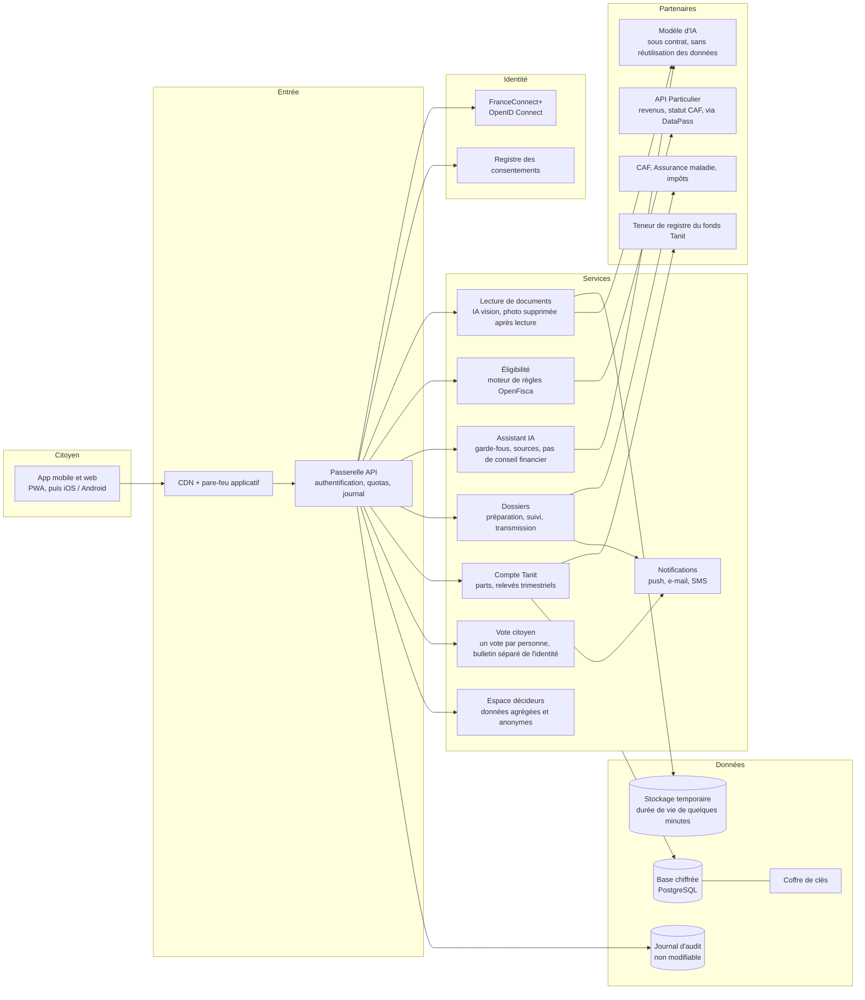

# Architecture de Tanit Citoyen

Principe : **les règles calculent, l'IA explique et prépare, le citoyen valide, l'organisme décide.**
Les droits sont calculés par un moteur de règles officiel (OpenFisca, le modèle socio-fiscal open source utilisé par l'administration française). L'IA lit les documents, explique et rédige les dossiers. Elle ne décide jamais.

## Schéma cible

## Les briques et ce qu'elles garantissent

| Brique | Rôle | Garantie |
| --- | --- | --- |
| Connexion FranceConnect+ | Identité vérifiée sans mot de passe propre à l'appli | L'appli ne voit jamais les identifiants |
| Registre des consentements | Ce que le citoyen autorise (documents, IA, statistiques), daté | Retrait possible à tout moment, chaque traitement vérifie le consentement |
| Lecture de documents | Photo → montants utiles | Image supprimée juste après la lecture, rien n'est gardé d'autre |
| Éligibilité (OpenFisca) | Calcul des droits par des règles officielles et testables | Résultat explicable et identique pour tous ; l'IA ne calcule pas les droits |
| Assistant IA | Explique, résume, rédige | Cite ses sources, renvoie vers l'organisme, aucun conseil en investissement |
| Dossiers | Prépare, fait valider, transmet, suit l'avancement | Rien n'est envoyé sans la validation du citoyen |
| Compte Tanit | Affiche les parts et les relevés du teneur de registre | Lecture seule : l'appli ne déplace jamais d'argent |
| Vote | Recueille les choix d'orientation | Un vote par personne ; le bulletin est séparé de l'identité |
| Espace décideurs | Projections et tests du montage | Données agrégées et anonymes uniquement |
| Données et sécurité | Base chiffrée, coffre de clés, journal d'audit | Hébergement en France sur un cloud qualifié SecNumCloud |

## Conformité

- **RGPD** : analyse d'impact (AIPD) avant lancement, délégué à la protection des données, droits d'accès, d'effacement et de portabilité depuis l'appli. L'IA ne prend aucune décision automatisée (article 22).
- **Règlement européen sur l'IA** : l'évaluation d'éligibilité aux prestations peut relever du « haut risque » (annexe III) si l'outil est opéré pour une autorité publique : documentation, supervision humaine, journalisation.
- **Accessibilité** : objectif de conformité RGAA.
- **Sécurité** : homologation selon le référentiel général de sécurité (RGS), tests d'intrusion, programme de signalement de failles.

## Aujourd'hui (prototype du hackathon) et demain

| Brique | Prototype | Version cible |
| --- | --- | --- |
| Interface | Vite, une page, français et anglais | PWA puis applications iOS et Android |
| Serveur | Node + Express, clé API côté serveur, limite de requêtes | Passerelle API + services séparés |
| Connexion | Simulée (FranceConnect fictif, code e-mail 123456) | FranceConnect+ |
| Consentements, démarches, votes | Gardés sur l'appareil | Base chiffrée côté serveur |
| Éligibilité | Estimée par l'IA, présentée comme estimation | OpenFisca + API Particulier |
| Transmission des dossiers | Simulée | Partenariats CAF, Assurance maladie, France Services |

## Feuille de route

1. **Hackathon (novembre 2026)** : prototype complet, parcours citoyen de bout en bout.
2. **Pilote (6 mois)** : un département, trois aides (prime d'activité, APL, complémentaire santé solidaire), avec des travailleurs sociaux et une maison France Services.
3. **National** : ouverture à tous, puis compte Tanit si la loi créant le fonds est adoptée.
