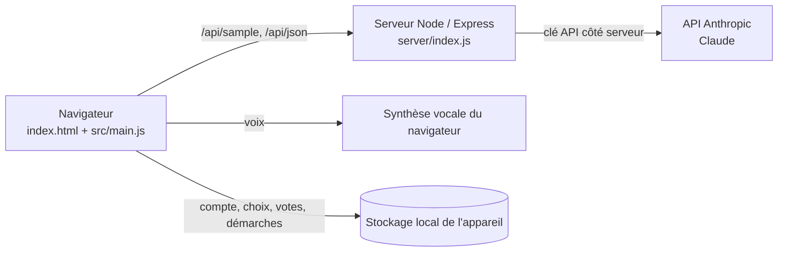

# Tanit Citoyen

> Prototype réalisé pour le **Sciences Po AI Hackathon 2026** (20 et 21 novembre 2026, Paris).
> Projet étudiant, non affilié à l'État ni à un organisme public.

**In English:** Tanit Citoyen is a mobile-first citizen app. An AI agent reads a payslip or tax notice, finds the social benefits a person is missing and prepares the application, which the citizen approves. The app also shows each citizen their share of *Tanit*, a proposed national public capital fund that turns part of existing levies into individually owned, long-term savings, and lets citizens vote on how it invests.

## Le sujet

### Le problème
- Le **pouvoir d'achat** est la première préoccupation des Français : 36 % ([Ipsos, Fractures françaises, octobre 2025](https://www.ipsos.com/fr-fr/fractures-francaises-2025)).
- Le **non-recours aux aides** est massif : 34 % pour le RSA, 50 % pour le minimum vieillesse des personnes seules. Première cause : le manque d'information, 37 % ([DREES, 2022](https://drees.solidarites-sante.gouv.fr/jeux-de-donnees-communique-de-presse/non-recours-aux-prestations-sociales-le-manque-dinformation-en)).
- La France manque de **capital patient** : plus de 500 Md€ dorment sur les livrets réglementés et environ 70 % de l'assurance-vie est en fonds euros, alors que les entreprises manquent de fonds propres de long terme (mémo Tanit, Carmen Guintrand).

### La solution
1. **Mes aides** : le citoyen photographie son avis d'imposition ou sa fiche de paie. L'IA lit le document, estime les aides auxquelles il pourrait avoir droit (prime d'activité, APL, complémentaire santé solidaire, chèque énergie…) et prépare le dossier. **Le citoyen valide, l'organisme décide.**
2. **Mon capital Tanit** : une part de 1 à 4 % des prélèvements existants devient une épargne au nom du citoyen, investie dans les infrastructures, les entreprises stratégiques, l'innovation et la solidarité. Simulateur, répartition et relevé trimestriel.
3. **Je vote** : les citoyens fixent les grandes orientations du fonds (transition écologique ou industrie souveraine, secteur prioritaire, niveau de risque). L'IA présente les enjeux de façon neutre.
4. **Espace décideurs** : projection du capital accumulé et agent qui teste le montage contre les critères de classement hors dette publique (SEC 2010, Eurostat).

Ce qui marche déjà ailleurs : MyWelfare en Irlande attribue automatiquement plus de 83 % des arrêts maladie, Ask Jamie à Singapour résout la moitié des demandes sans centre d'appel, Bürokratt en Estonie relie les assistants de toutes les administrations.

## L'application

| Écran | Contenu |
| --- | --- |
| Langue | Français ou anglais |
| Présentation | Trois écrans |
| Connexion | FranceConnect (simulé), e-mail et code (démo : `123456`), ou sans compte |
| Consentements | Un interrupteur par usage : lecture de documents, IA, statistiques |
| Accueil | Carte du capital Tanit, questions fréquentes, accès aux votes et aux aides |
| Capital | Simulateur, compartiments, poche européenne, relevé trimestriel |
| Je vote | Trois votes d'orientation |
| Mes aides | Photo du document, estimation des aides, dossier pré-rempli |
| Question | Assistant conversationnel |
| Compte | Mes démarches et leur suivi, confidentialité, effacement des données, préférences, mentions légales |
| Politique de confidentialité | Données, finalités, durées, destinataires, droits |

Accessibilité : gros boutons, contrastes forts, taille du texte réglable, lecture à voix haute, mode sombre, navigation au clavier.

## Architecture

**Principe : les règles calculent, l'IA explique et prépare, le citoyen valide, l'organisme décide.**

### Prototype (ce dépôt)



- `index.html` : interface (HTML et CSS).
- `src/main.js` : logique de l'appli, textes français et anglais.
- `src/claude.js` : appels au serveur (texte en streaming, réponses JSON, réduction des photos).
- `server/index.js` : seul endroit qui voit la clé API. Schémas JSON validés, limite de 20 requêtes par minute, sert aussi le site compilé.
- `.claude/agents/` : agents de recherche utilisés pendant le projet (veille sondages, benchmark international, analyse juridique, retours terrain, jury contradicteur).

### Version cible

Connexion FranceConnect+, registre des consentements, calcul des droits par **OpenFisca** (moteur de règles socio-fiscales open source utilisé par l'administration) et API Particulier, transmission des dossiers aux organismes, registre des parts Tanit, vote séparé de l'identité, hébergement en France sur un cloud qualifié SecNumCloud. Détail et schéma complet : [ARCHITECTURE.md](ARCHITECTURE.md).

## Lancer le projet

Prérequis : Node.js 22.9 ou plus récent.

```bash
npm install
cp .env.example .env      # Windows : Copy-Item .env.example .env
# coller la clé dans .env : ANTHROPIC_API_KEY=sk-ant-...
npm run dev               # http://localhost:5173
```

Sans clé, l'appli fonctionne avec des exemples et indique que l'assistant n'est pas disponible.

Production : `npm run build` puis `npm start` (un seul serveur sert le site et l'API).

## Limites connues

- Connexion, transmission des dossiers et compte Tanit sont **simulés**.
- Les aides sont **estimées par l'IA**, pas calculées par les règles officielles : la version cible utilise OpenFisca.
- Les rendements et le barème de contribution sont des **hypothèses de l'équipe**, à valider.
- Les données du compte restent sur l'appareil.

## Équipe

Rym Badri (ingénieure, build), Carmen Guintrand (droit et finance, autrice du mémo Tanit), Anatole (affaires publiques), Yves et Victor (finance et stratégie).
